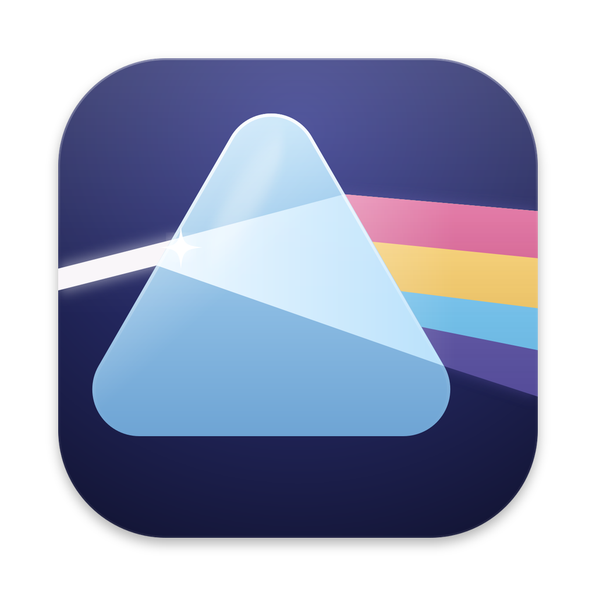

<div align="center">
  
  <h1>Prism</h1>
  <p><strong>A fast, keyboard-friendly browser for the photos and videos on your computer.</strong></p>
  <p>
    <a href="#install">Install</a> ·
    <a href="#getting-around">Getting around</a> ·
    <a href="#keyboard-shortcuts">Shortcuts</a> ·
    <a href="#for-developers">For developers</a>
  </p>
  <p>
    
    <a href="LICENSE"></a>
  </p>
</div>

---

Point Prism at a folder and browse it straight from disk: no importing, no library to manage,
nothing uploaded anywhere.

- 🗂️ **Your folders, as they are.** A sidebar of folders with covers, a grid of what's inside,
  a filmstrip that runs through every subfolder too, and a reader for comics and scanned books.
- 🎞️ **Photos and videos.** Common photo formats and videos side by side, with playback built
  in.
- ⚡ **Quick with big folders.** Thumbnails are made on demand and kept, so folders open fast
  the second time and scrolling stays smooth with thousands of files.
- 🔄 **Always up to date.** Files added, renamed, edited or removed on disk show up without a
  refresh.
- 🔍 **Look closer.** Pinch or ⌘-scroll to zoom, drag to pan, run a slideshow, or show a photo
  full screen.
- ⌨️ **Made for the keyboard.** Every action has a shortcut, and you can change them all.
- ♿ **Accessible.** Works with screen readers, and follows your system's accent colour,
  Increase Contrast and Reduce Transparency settings.

## Install

Download the installer for your system from the
[latest release](https://github.com/subwai/prism/releases/latest):

| System  | Download                                      |
| ------- | --------------------------------------------- |
| macOS   | `.dmg` for Apple silicon or Intel             |
| Windows | `.exe` installer                              |
| Linux   | `.AppImage` (make it executable, then run it) |

Prism updates itself: it downloads new versions in the background and installs them the next
time you quit. Once one is ready, **Prism › Restart to Update** (**File › Restart to Update** on
Windows) installs it right away.

> [!NOTE]
> Prism is in testing, so **macOS builds aren't notarized.** The first launch may ask you to
> confirm you want to open it, and updates need the test signing certificate trusted in Keychain
> Access (see [Releasing](docs/releasing.md#self-signed-macos-test-builds)).

## Getting around

1. **Open a folder** with **File › Open Folder…** (⌘O). Prism opens it again next time.
2. **Browse** in the grid, which shows the folder's own photos and subfolders, or press ⌘G to
   switch to the filmstrip, which also includes everything in its subfolders, and again for the
   reader, which shows the folder's photos one below the other: scroll through them, or turn a
   page with Left and Right.
3. **Preview** with Space to take a quick look at a photo or peek inside a folder, and
   press **Enter** to open it.
4. **Manage files** from the right-click menu: rename them, or reveal them in Finder, File
   Explorer or your file manager.

Use the sliders to size thumbnails, folder covers and the reader's pages; double-click a slider
to reset it.

## Keyboard shortcuts

Every action has a shortcut. The menus show them beside each item, buttons show theirs in their
tooltips, and **File › Default Keyboard Shortcuts** lists them all.

### Change your shortcuts

Shortcuts work like VS Code's. **File › Keyboard Shortcuts…** opens your own `keybindings.json`,
and **File › Default Keyboard Shortcuts** shows the built-in ones to copy from. Your rules apply
on top of the defaults as soon as you save:

```jsonc
[
  // Press N for the next photo in the viewer.
  { "key": "n", "command": "next", "when": "viewerFocus" },
  // Stop Shift-S from starting a slideshow.
  { "key": "shift+s", "command": "-slideshow" },
]
```

For any key, the last rule that applies wins, and a command starting with `-` removes the
defaults for it. Prism points out any rule it can't use and applies the rest.

## For developers

Prism is built with Electron, React Router and TypeScript.

- **[Development](docs/development.md)**: set up, run, test and lay out the code.
- **[Architecture](docs/architecture.md)**: how the processes, routes, data and photo API fit
  together.
- **[Releasing](docs/releasing.md)**: changesets, release builds, automatic updates and
  signing.

See the [changelog](CHANGELOG.md) for what's new.

## License

Prism is free software under the [GNU General Public License v3.0](LICENSE). You may use, change
and share it, and anything you distribute that is built from it must be released under the same
license, with its source code.

All earlier versions of Prism in this repository's history, and their releases, are also
available under the GNU General Public License v3.0.
